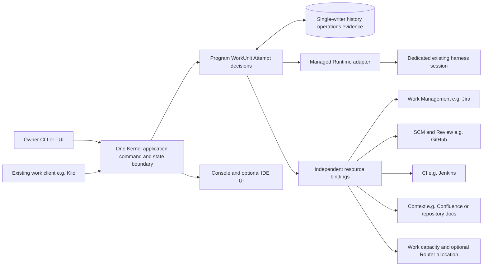
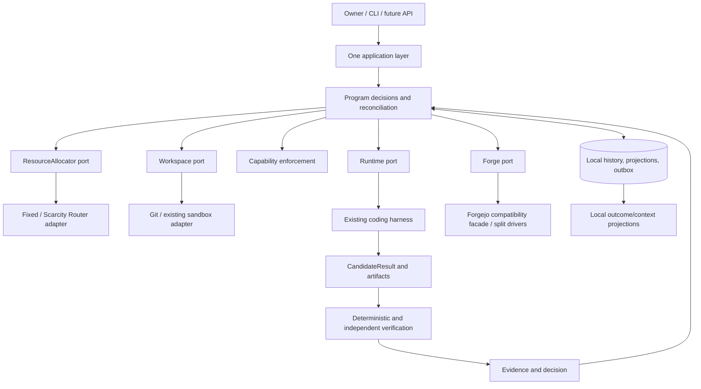

# Unified Work Coordination Target

The owner-authorized revision is recorded in [ADR 0012](../adr/0012-unified-work-coordination-and-drivers.md).
PR #104 integrated it at `ace7175e087cd70e207594f5631c8f4f70fabfd4` on 2026-10-27.
It is the single current target, not an implemented capability; older push/gateway-only diagrams
are historical, not alternate architectures. Canonical publication/acceptance evidence is in #103. See the
[publication plan and current evidence](backlog-alignment.md) and [roadmap](successor.md).

## One Core, Two Modes

Kernel owns engineering work identity, approved intent, dependencies, selection, admission, claims,
work-level capacity/budgets, review/acceptance, effect recovery and owner decisions. It reuses existing
harnesses and external work resources. It is not a tracker, coding agent, CI platform, model catalogue,
quota collector or gateway. Kilo remains a user's primary agent interface; Codex remains the bounded
managed reference, not the required product runtime.

This describes responsibility, not network endpoints or a required deployment. CLI, MCP, SDK/API and
ACP can adapt supported boundaries. None supplies lifecycle, sandbox or authorization guarantees
merely by its protocol name. No mandatory server fleet, private repository, cloud account or telemetry.

Pull clients request work through the same decision path that push initiation uses. Only the latter
may own a dedicated native process. Both carry the same approved spec, Attempt, generation, authority,
deadline, resource reservation, operation identities and candidate/evidence subjects. The selected
profile states whether task-scope settlement is cooperative or managed; no implied session takeover.

## Lifecycle And Failure Boundaries

The semantic sequence is refresh -> validate explicit dependencies -> approve/amend -> claim/reserve
-> handoff -> progress -> submit -> verify/review/remediate -> accept -> external synchronization.
These are conceptual stages, not extra enums or an executable DSL. Exact contracts and refusal cases
are defined in ADR 0012; existing implemented values below remain distinct.

One single-writer command atomically checks current revision/authority, DAG eligibility, work/resource
conflicts and capacity before reserving a claim generation. The work claim is distinct from an outbox
delivery claim. Late/stale generations cannot publish or invoke Kernel effects. Lease expiry prevents
new authority but does not terminate an agent or justify a conflicting successor. Uncertain resources
remain retained/quarantined while unrelated work can proceed. No distributed consensus or exactly-once
external effects is asserted.

Intent, delivery attempt, native receipt, runtime terminality, task-scope settlement and acceptance are
different facts. In pull, revocation withdraws Kernel authority and requests cooperative stop; Kernel
cannot kill the owner's external session. In push, cancel/termination targets only the exact owned
supported worker, and success needs its profile's witness. Missing heartbeat, UI close or an interrupt
receipt never proves descendants stopped. Unknown mutation/settlement blocks acceptance/publication
and conflicting reuse. A pure immutable candidate snapshot does not settle the producer's effects.

Trusted verification precedes candidate-controlled tooling; independent product review is a fresh
conversation on exact candidate/base/spec/policy. A new candidate needs fresh applicable evidence.
Acceptance enables successors atomically, but tracker updates, PR effects and merge remain separate
authorized operations with native preconditions and durable receipts. No transport, frontend or agent
sets state directly. #60 acceptance does not substitute for the component implementations.

## Drivers And Identity

Use separately bound Work Management, SCM/Code Review, CI/Verification, Knowledge/Context,
Harness/Execution and Resource/Capacity responsibilities. A provider can implement several families;
a task need not use the same provider or credentials for them. The concrete port split and Forgejo
facade migration are specified in ADR 0012, not a parallel generic integration framework.

Every source identity carries instance/host/port, project/namespace, opaque native key, resource kind,
driver/contract version, exact revision or explicit unavailability and provenance. Internal work IDs
are not remote issue numbers. Preserve native dependency/update/check semantics alongside validated
common fields. Incomplete/moving/permission-limited reads remain unknown. Required unsupported
operations, compatibility or mutation preconditions refuse rather than silently weakening policy.

All drivers share existing journal/effect principles: bind exact operation/authority before send,
persist receipts and observed outcomes, reconcile ambiguity and never blindly retry unknown effects.
There is no cross-provider transaction or promise that another provider implements Forgejo AGit.
Existing Workspace, artifact storage and authority ports are retained; no speculative IAM, artifact
service or notification framework is added.

## Resources, Clients And Trust

Kernel work policy governs project/task concurrency, workspaces, attempts, review/remediation,
time and owner-approved economic envelopes. Router governs model execution sources, subscriptions,
compatibility, ranking/admission and gateway evidence. Preserve sourced unitful money/quota/tokens/
time/attention and unknowns; no invented budgets, billing accuracy or quota-token conversion.

Basic work coordination uses an explicitly acknowledged existing harness configuration without
requiring Router gateway compatibility or intercepting every model HTTP call. That path reports model
resource control/consumption as unavailable where not observed. Strict routing, exact pins, inference
admission, hard quota or no-hidden-call profiles still require proven Router/harness capabilities and
refuse otherwise. #52 remains a real full executable-integration obligation; its Kilo multipart and
fail-open-plugin negative evidence is preserved, not flattened away or made a global work gate.

Console, CLI/TUI and optional IDE/Kilo UI consume the same owner-served snapshot/events/command
authority. An agent work integration and a UI extension are distinct clients. Authentication and
owner/worker/observer scopes are enforced by Kernel, not a plugin-supplied principal. Durable facts
are distinct from lossy progress; producer-scoped cursors, gap/resync, dedupe and current-revision
commands are required. No client opens active exclusive SQLite or implements a second scheduler.

ADR 0011's original deadline, clock/recovery requirements, same-principal trusted-development
limitations and no strict syscall-expiry guarantee remain. ADR 0008 is verification-only. Pull is
weaker cooperative task control, not managed process enforcement. A sensitive task requiring an
unproved capability refuses that profile without prohibiting ordinary explicitly trusted work.

## Current Implementation Cut

Inspected `develop` `26c7eb15a71affc11aba760387e2dae806053d4b`, 2026-10-26:

| Evidence | Actual status | Still missing |
| --- | --- | --- |
| Domain, SQLite, outbox/artifacts, source ownership | Integrated bounded foundations | Ordinary work claims/planning/selection and shared multi-resource control |
| #49/#51 ordinary intake | Inert approved DRAFT and strict recommendation handoff/recovery | Ordinary Program activation/dispatch and rich semantic relevance; no prose authority |
| #54 / PR #92 | Durable synthetic-first product review/remediation implementation | Installed ordinary/native composition and profile-specific acceptance, not another review engine |
| #90 / PR #93 | Bounded cancellation identity/owned-group settlement recovery | Normal-completion settlement, escaped descendants and missing cold witness; ADR 0011 boot-clock projection is still unimplemented |
| #100 | Executable pinned offline Kilo/Router incompatibility and plugin negatives | Production Kilo adapter, Router main/tool/helper/lifecycle conformance |
| #101 | Codec-v3 immutable utilized-MI reference, local/provenance-only | Direct content retrieval/freshness and live reception; no knowledge authority upgrade |
| #102 | Synthetic WSL-storage, future-schema and ciphertext byte/mtime safety | Real platform/installed migration journeys and key/profile/release decisions |
| Codex Runtime / Forgejo / status/export | Bounded dedicated runtime and exact-SHA AGit; offline directory views | Driver split/heterogeneous adapters and served shared commands/events, full outcomes |

No whole-product completeness, live inference, production operation or installation support beyond
named evidence is claimed. The historical v1.0 shared source file was unavailable in accessible public
sources; use only recorded decisions, not invented unseen contents.

## Retained Foundations

## Smallest Kernel

A local package that owns bounded Program intent, checks legal actions, durably records decisions,
reconciles external operations and accepts evidence-bound results. Existing coding runtimes do the
intelligent work. Existing Git, forges, CI, containers and allocators supply mechanisms.

These are responsibilities and call boundaries, not services. The bounded current topology has one
controller per store, a local SQLite database and local artifact storage. Target workers need proved
isolation; current trusted-development external processes do not provide it.
Context compilation, authority checking, verification orchestration and outcome projection belong
inside this package, not four new products.

## Authority Map

| State | Authority | Kernel representation |
| --- | --- | --- |
| Intent, Program graph, acceptance criteria, limits | Owner-approved versioned ProgramSpec | Durable snapshot and decision history |
| Legal actions, WorkUnit readiness, accepted outcomes, grants | Kernel application/domain layer | Atomic journal plus current projections |
| Work records / code / checks / context | Independently selected tracker / SCM / CI / knowledge provider | Qualified native records and observations; no monolithic forge or fictitious authoritative copy |
| Runtime liveness, session identity, raw usage | Runtime / authenticated adapter observations | Receipts, freshness and uncertainty; completion does not imply acceptance |
| Quota and reservation reality | Allocator/provider | Versioned observation/receipt, not an invented global quota balance |
| Artifact contents | Content-addressed user storage / Git objects | Validated digests and manifests, not model prose |
| Secrets | User-selected existing credential store | References available only to the trusted broker |
| Search, embeddings, summaries, UI | Derived views | Rebuildable, never the only copy of truth |

An issue can represent a requirement or WorkUnit but is not the Program itself. Forge observations
do not directly set Kernel status. Authenticated domain commands validate and record their meaning.
Forge edits to requirements require a ProgramSpec amendment, not silent adoption by a worker.

## Retained Vocabulary

Durable means represented in local history/storage, not necessarily its own table or class. IDs are
opaque within an installation; external identities are qualified by adapter/endpoint/repository.

| Concept | Meaning and owner | Identity / durability / lifecycle | Explicitly not |
| --- | --- | --- | --- |
| Objective | Owner's intended outcome within ProgramSpec | Versioned value, no independent lifecycle initially | An extra orchestration service |
| Program / ProgramSpec | Kernel's bounded graph and owner's immutable intent, criteria, resource/authority envelope | Program ID; spec revision+digest; draft, active, paused, completed or cancelled | A chat, ticket queue, generic workflow language, or harness session |
| WorkUnit | Kernel-owned bounded obligation and graph node, dependencies, required inputs/outputs and acceptance policy | ID scoped to Program; immutable spec revisions; implemented states pending, ready, active, satisfied or cancelled | An Attempt or necessarily an issue |
| Attempt / AttemptSpec | One execution try with pinned inputs, allocation, agent definition, policy, workspace and context | New ID each try; immutable effective spec digest; implemented states prepared, executing, finished, failed or cancelled; candidate/verification/acceptance are separate records | A mutable session reused to erase failures; `Run` is only an upstream synonym |
| Operation | Kernel's record of one intended external effect and its delivery/observations | Stable ID, input digest and dedupe key; intent through receipt/observation to resolved disposition or uncertainty | Proof of effect merely because intent exists |
| Artifact | Produced or consumed bytes/Git object owned by the user | Digest plus locator, size/type; staged then durable, retained or explicitly collected | Evidence of correctness by existence alone |
| CandidateResult | Untrusted proposed output from an Attempt | Immutable candidate ID, spec and artifact subjects; pending verification, rejected or accepted by a separate decision | A trusted verdict |
| Evidence | Attributed observation about an exact subject | ID/digest, producer, tool/version, timestamps; immutable, may be superseded | A verdict or an authority grant |
| Finding | A specific unmet obligation identified by verification | ID, subject and stable/versioned fingerprint; open, resolved, superseded | Free-form status-setting instructions |
| AcceptedResult | Kernel's acceptance decision binding candidate, evidence, policy and spec | Durable decision ID; historical acceptance immutable; applicability can later be superseded/invalidated | Automatic merge, production deployment or universal correctness |
| Outcome | Local view of consumption and acceptance across related Attempts | Derived from durable observations/decisions, with correction lineage | Another source of workflow authority |
| ResourceRequest / Allocation | Requirement vector / allocator selection with rationale | Request identity and immutable selection snapshot; record before dispatch | A vendor-specific ranking or execution permission |
| Reservation | Optional allocator-owned hold with a validated receipt | External reference, units, expiry; acquired/released/expired/uncertain | A field claiming reserved capacity without an external hold |
| Budget / Policy | Owner's limits and decision rules | Version/digest; immutable values selected by a spec; superseded explicitly | Custom policy DSL or routing implementation |
| AuthorityGrant | Trusted broker's bounded delegation from owner authority | Grant ID and exact scope/digest; issued, consumed where single-use, expired or revoked | An agent claiming permission |
| HumanGate | A concrete owner judgment/authority requirement | ID, typed reason, subject digest and required decision; open/resolved/obsolete | Generic `needs_human`, a failed test, or a retry counter |
| Runtime / Workspace | Execution mechanism / reproducible execution environment | Adapter ID/version and external handle; provisioned/active/reconciled/disposed as appropriate | Program truth or automatic sandbox safety |
| ContextPackage | Bounded, source-pinned compiled input | Manifest digest and compiler/policy version; generated then retained or reproducible | Conversation history as project memory |
| Event / Decision | Durable fact / legal choice with reason | Journal ID, aggregate sequence, schema, actor, correlation and causation | Arbitrary row mutation or log parsing |

Task identity associates approved engineering meaning and external subjects with a Program; it is not
a second lifecycle or a numeric tracker key. `Node` is not a second entity: the WorkUnit is the graph
node. The public bounded `TaskSpec` is an input contract, not a competing core WorkUnit/Attempt lifecycle.
Do not add `job`, `child` or `run`
as competing core synonyms. Runtime vocabulary stays in adapters. The labels above are historical
target vocabulary; actual implemented enums/codecs determine serialized state, not this table.

## Critical Invariants

1. Code, not LLM prose, determines transitions and authority. No `set_state` or `force_status` API.
2. Every dispatched Attempt has immutable inputs, a durable Operation and valid bounded authority.
3. State, history, command dedupe and pending effects commit atomically. No network I/O in that transaction.
4. Intent != dispatch != domain acknowledgement != external completion != engineering acceptance.
5. Unknown effects are reconciled before retry; leases/fences cannot magically stop external workers.
6. Only verified, exact-subject evidence can support acceptance. New head/remediation requires fresh checks.
7. Workers cannot mint owner authority, access control-plane storage, or weaken their own verification gates.
8. Recoverable defects/waits stay autonomous within budgets. HumanGate requires an actual decision.
9. Providers, runtimes, forges and allocators are replaceable. No private dependency or mandatory cloud.
10. Context and outcome history are user-owned; derived indexes and telemetry are not authoritative state.

## Retained Legal Actions And Recovery

The first Program graph is a validated finite DAG, not arbitrary workflow code. Readiness requires
accepted predecessor outputs still applicable to the pinned spec. Planning can be assisted by an LLM,
but code checks cycles, references, scope, budgets and authority before activation. An amendment gets
a new spec revision and re-evaluates affected readiness/acceptance without deleting old decisions.

Conceptual operation names, not working API/CLI instructions: `start_program`, `next_action`, `report_candidate_result`,
`record_evidence`, `accept_result`, `request_external_operation`, `reconcile_operation`,
`grant_authority`, `record_owner_decision`. CLI, REST and MCP must not each implement those semantics.
Public transport routes and exact method signatures are deferred.

WorkUnit rejection does not require a new Program: a new Attempt can remediate within the same
obligation and authority envelope. A terminal Attempt is not reopened. Verification can use a fresh
independent runtime invocation with its own pinned specification and consumption. Acceptance updates
the WorkUnit and enables successors in one transaction. Resource/remote waiting and controller
health are conditions with receipts and next-observation deadlines, not guessed from chat activity.

On restart, load schema/policies, validate projections, recover pending operations, reconcile remote
reality, quarantine uncertain concurrent writes, and only then authorize new dispatches. Surviving
truth includes Program/spec graph, command dedupe, operation identities/receipts, authority grants,
Attempt inputs, candidate/evidence/artifact bindings, findings and consumption. A runtime transcript
may help continuity but losing it must not lose this truth.

## Historical A0 Limits

A0 implemented only a resource-boundary proof. It did not implement the lifecycles above, SQLite
persistence, runtime/forge/sandbox adapters, context compilation or verification. There is no coding
agent, UI, deployment, adaptive router, general scheduler, new protocol or Program engine. The
[coverage roadmap](successor.md) separates subsequent built subsets from remaining acceptance and
registered work. Do not use this historical exclusion to erase code already delivered or known goals.
